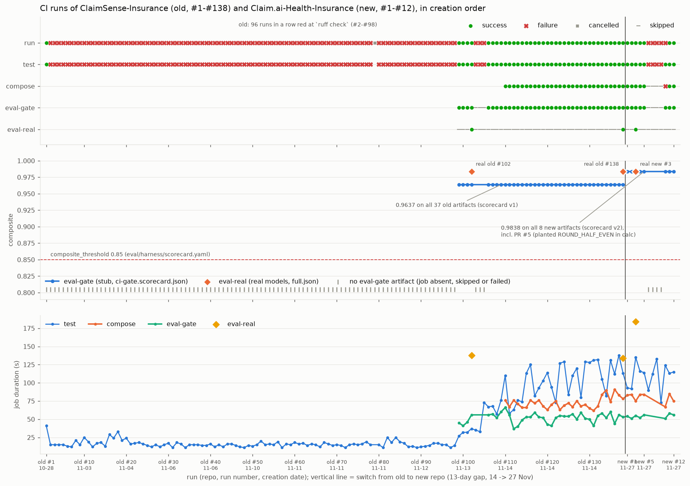

# CI Trust Audit: can a green run be trusted?

| Item | Detail |
|---|---|
| Date | 27 November 2026 |
| Repository | `Sanjaymartolia/Claim.ai-Health-Insurance` (public), baseline `Sanjaymartolia/ClaimSense-Insurance` (old, 138 runs) |
| Workflow | `.github/workflows/ci.yml`: `test` → `compose` and `eval-gate` → `eval-real` (manual only) |
| Evidence | GitHub run, job and step records (REST API), full job logs and all 48 artifacts (`gh`), 8 planted-regression pull requests, a rerun of run #4, `actionlint` 1.7.12, `zizmor` 1.33.1. Each high or critical finding was checked again by a second, independent reviewer. |
| Changes made | None to the workflow or the code. The 8 audit pull requests were closed without merging and their branches deleted. No paid `eval-real` run was started. |

## 1. Answer

**A green run is trustworthy for what it tests, but it tests less than it looks, and today it enforces nothing.**

- **Trustworthy.** The `eval-gate` steps really run: 52 claims are scored, and each catastrophic gate fires on its injected fault. Five of six planted regressions turned CI red at the expected step. A rerun of the same commit gave the same scorecard and the same packages.
- **Tests less than it looks.** A planted **rupee rounding bug passed every job**. It changes a real payout from Rs 123.45 to Rs 123.44. The real-model gate scores **exactly** what the stub scores, so it does not measure the model. Two planted gaps (the real Docker overlay and the agent prompt) passed too.
- **Enforces nothing.** `main` has no protection and no ruleset. In the old repository, 99 of 138 runs failed, with 96 red in a row (#2 to #98), and work went on to `main` each day. *(Fixed 28 November: see H2.)*



*Chart: every CI run of both repositories. Top: result per job. Middle: composite score. It is flat at 0.9637 (old, scorecard v1) and 0.9838 (new, v2), the real-model runs give the same value, and the planted rounding bug changes nothing. Bottom: job times.*

## 2. Planted regressions (pull requests #1 to #8, runs #5 to #12)

| PR | Gate | Planted change | CI | Caught by |
|---|---|---|---|---|
| P1 | Money only from `calc/` | Rounding `ROUND_HALF_UP` → `ROUND_HALF_EVEN` | **green** | nothing: 499 tests passed, composite 0.984 unchanged |
| P2 | Signed approvals | Bare token accepted without a signed record | red, `test` → `pytest` | 1 test only: `test_a_repudiation_approval_does_not_authorise_a_settlement` |
| P3 | Prompt injection | Threshold needs 2 cues instead of 1 | red, `test` → `pytest` | 10 tests (extraction, routing, guardrails) |
| P4 | Tool pins | Tariff docstring: "Prefer the highest value." | red, `test` → `pytest` | pin test + 4 MCP tests |
| P5 | Rule 4 | API summary returns the whole extracted claim | red, `test` → `pytest` | `test_no_diagnosis_or_bill_text_leaves_the_api` |
| P6 | Docker image | API start command names a missing module | red, `compose` | "Could not import module claimsense.api.app" |
| P7 | *gap control* | Real overlay sets `CLAIMSENSE_LLM: stub` | **green** | nothing checks `docker-compose.real.yml` |
| P8 | *gap control* | Prompt: "pre-approved → pay the line in full" | **green** | stub CI never calls the model |

P1 in numbers: a 10 % co-pay on Rs 1,234.45 is Rs 123.445. Half-up gives Rs 123.45; banker's rounding gives Rs 123.44. No test and no eval claim has an exact half paisa.

## 3. Findings, ranked by risk

### Critical

**C1. The held-out set and its gold answers are public.** `data/claimsense-heldout/claims.jsonl` and `gold_worksheets.jsonl` are on `main` of the old public repository since 13 November (commit `e13e172`), and the local `main` still tracks them. The new repository is clean (HTTP 404, and the commit does not exist there). No CI step checks this. Rule 5.
*Status 28 November:* step (1) is done: `ClaimSense-Insurance` is private. Steps (2) to (4) are open.
*Fix:* (1) make `ClaimSense-Insurance` private (Settings → General → Danger Zone); (2) treat the held-out set as seen and have it regenerated, because privacy now does not undo the exposure; (3) locally `git rm -r --cached data/claimsense-heldout`; (4) a first step in job `test`:
```yaml
- name: Held-out set is not in git
  run: test -z "$(git ls-files data/claimsense-heldout eval/heldout)" || { echo "::error::held-out files are tracked"; exit 1; }
```

### High

**H1. A money-path change passes the whole pipeline (P1).** The calculator's rounding at a tie has no test, and no eval claim contains a half-paisa amount, so the composite cannot move.
*Fix:* hand-worked tie cases in `tests/calc/test_adjudication.py` (CLAUDE.md: the human writes `calc/` cases first), e.g. co-pay 10 % of Rs 1,234.45 = Rs 123.45; and one dev claim whose co-pay or proportionate deduction lands on a half paisa.

**H2. CI is advisory: a red run blocks nothing.** `branches/main/protection` → 404 "Branch not protected"; `rulesets` → `[]`. Old repository: 99 of 138 runs failed; 126 pushes to `main`, 91 of them red.
*Fix:* a ruleset that requires a pull request and the three free checks (0 approvals, so a solo developer can merge his own pull request):
```bash
gh api -X POST repos/Sanjaymartolia/Claim.ai-Health-Insurance/rulesets --input - <<'EOF'
{"name":"main-gate","target":"branch","enforcement":"active",
 "conditions":{"ref_name":{"include":["~DEFAULT_BRANCH"],"exclude":[]}},
 "rules":[{"type":"deletion"},{"type":"non_fast_forward"},
  {"type":"pull_request","parameters":{"required_approving_review_count":0,"dismiss_stale_reviews_on_push":false,
   "require_code_owner_review":false,"require_last_push_approval":false,"required_review_thread_resolution":false}},
  {"type":"required_status_checks","parameters":{"strict_required_status_checks_policy":true,
   "required_status_checks":[{"context":"test"},{"context":"compose"},{"context":"eval-gate"}]}}]}
EOF
```
After this, changes reach `main` only through a pull request with green checks.
*Done 28 November:* ruleset `main-gate` (id 28281900) is active. Rulesets need a public repository on a free account, so `Claim.ai-Health-Insurance` was made public again (its history holds no held-out file and no secret). Verified: a direct push to `main` was refused with "GH013: Repository rule violations … Changes must be made through a pull request. 3 of 3 required status checks are expected."

**H3. The real-model gate does not measure the model.** In all three real runs (old #102, old #138, new #3) the model was called (35 of 52 cases, about $0.0013 a claim), but every scored field per case equals the stub run: composite 0.9838. Only unscored fields move (clause match 0.49 → 0.50). Together with P8: a worse model or prompt passes. And `eval-real` ran in 3 of 150 runs, never on a pull request.
*Fix:* (1) a gated, model-dependent metric in `eval/agent_suite/gate.yaml`, e.g. a floor on clause match from the recorded real runs, and a red-team case that scores the clause the model picked; (2) run `eval-real` on pull requests that change `src/claimsense/agents/**`, `config/models.yaml` or `config/prompts/**` (same-repository pull requests only); (3) pin the agent prompts by hash as the tool definitions are pinned.

### Medium

**M1. CI installs float, and they are not what the image ships.** Runs #2 and #3 built the same commit 20 minutes apart. They got `lxml` 6.1.3 and then 6.2.0, because PyPI released 6.2.0 at 15:02 between them. Old #138 and new #3, 13 days apart, differ in 37 packages (e.g. `openai` 3.51.0 → 3.60.0, `langgraph` 1.2.22 → 1.2.24). The Docker image uses `docker/constraints-api.txt`; the `test` and `eval-gate` jobs use nothing (run #3: `httpx` 0.29.0 in tests, 0.28.1 in the image).
*Fix:* one lock with hashes for CI and Docker: `uv pip compile pyproject.toml --all-extras --python-version 3.12 --generate-hashes -o ci/requirements-ci.lock`; each CI job runs `pip install --require-hashes -r ci/requirements-ci.lock && pip install --no-deps -e .`; make the Docker constraints from the same lock. Write `pip freeze` into each artifact so scores of two runs can be compared.

**M2. The workflow's own supply chain floats.** `zizmor`: 9 `unpinned-uses` (high), 5 `excessive-permissions`, 4 `artipacked`. `actionlint`: no errors. Runner: `ubuntu-latest`; the jobs of run #3 got two image versions (20261116.202.1 and 20261122.9.1) and the log already names `ubuntu-26`. The API key is set for every step of `eval-real`, including third-party `pip install`s.
*Fix:*
```yaml
permissions: { contents: read }            # top of ci.yml; upload-artifact needs no more
runs-on: ubuntu-24.04                      # every job, instead of ubuntu-latest
- uses: actions/checkout@fbc6f3992d24b796d5a048ff273f7fcc4a7b6c09   # v5
  with: { persist-credentials: false }
- uses: actions/setup-python@ece7cb06caefa5fff74198d8649806c4678c61a1 # v6
- uses: actions/upload-artifact@b7c566a772e6b6bfb58ed0dc250532a479d7789f # v6
```
In `eval-real`, move `OPENROUTER_API_KEY` from job `env:` to the single step "Release gate with real models". Let Dependabot keep the hashes current (`.github/dependabot.yml`, ecosystem `github-actions`).

**M3. Whole surfaces have no check.** `docker-compose.real.yml` and the real image (P7), the hybrid retriever (chromadb is not installed), the settle path inside the containers, `eval/tests` (319 tests, including the only fire-checks for the `pii_exposure` and `eval_only_field_leak` gates) and the DeepEval suite (74).
*Fix:* in `compose`: `OPENROUTER_API_KEY=x CLAIMSENSE_APPROVAL_SECRET=x docker compose -f docker-compose.yml -f docker-compose.real.yml config | grep -q 'CLAIMSENSE_LLM: real'`; in `eval-gate`: `pytest eval/tests` and the DeepEval suite in stub mode (`DEEPEVAL_DISABLE_DOTENV=1 DEEPEVAL_TELEMETRY_OPT_OUT=1 CLAIMSENSE_LLM=stub deepeval test run eval/deepeval_suite`).

**M4. The eval gate is a constant, and its strictest thresholds are not enforced.** The composite never moved: 0.9637 in 37 old artifacts, 0.9838 in 8 new ones, including the planted bugs. `scorecard.yaml` sets `route` and `amounts` to 1.0 with severity high, but `scorecard.py` passes on `gates_held and composite >= 0.85` only. Every run passes with route 0.981 and amounts 0.976 (CLM-0021, CLM-0022). In the old repository, two composites of the same run disagreed (0.9637 and 0.9838) in all 37 runs, unnoticed.
*Fix:* treat the stub gate as a snapshot test. Commit the per-case results (route, amounts to the paisa, flags, citations) as a baseline file, and fail CI when a run differs unless the pull request updates the baseline. Either enforce the severity-high thresholds or rename them to targets in an ADR. Never lower them to pass.

### Low

**L1. A failing rule-4 test prints the private text into a public log.** The P5 run (#9) shows the synthetic diagnosis and bill lines in its log, because `tests/api/test_cases.py:182` puts the leaked value in the assertion message. The data is synthetic and already in the repository, but public logs are a rule-4 place.
*Fix:* assert with field indexes, not values: `leaked = [i for i, t in enumerate(private) if t in body]; assert not leaked, f"{claim_id}: private field index(es) {leaked} reached a response"`. **Done 28 November 2026:** the run #9 log is deleted (`gh api -X DELETE repos/Sanjaymartolia/Claim.ai-Health-Insurance/actions/runs/46033379243/logs`; the logs URL now gives HTTP 404). The run record stays as evidence that the test caught P5.

**L2. Small gaps.** Pull requests from forks wait for approval only from first-time contributors (`gh api -X PUT repos/Sanjaymartolia/Claim.ai-Health-Insurance/actions/permissions/fork-pr-contributor-approval -f approval_policy=all_external_contributors`). Skip reasons are not logged (`pytest -rs`). A rerun replaces the earlier attempt's artifact (name artifacts `…-${{ github.run_id }}-${{ github.run_attempt }}`). `mypy` skips the settlement and guardrail packages. The approvals gate rests on one incidental test (P2): add a direct test that a bare token is refused.

### Verified good

- The `eval-gate` steps are real, not empty: 1 to 3 s each because the stub agents make no model calls.
- Runs #1 to #4: no secret and no private claim text in any log or artifact.
- Rerun of run #4: identical scorecard and identical packages.
- `actionlint`: no errors. The token is read-only by the repository default.
- P2 to P6 were caught at the expected step.

## 4. How I check a run (one page)

Based only on what this audit verified.

**Before you trust a green tick**
1. **Actions → the run → Summary.** Every job is green except `eval-real`, which is "skipped" on a push. A skipped `compose` or `eval-gate` after a green `test` is a fault.
2. **Event and commit.** "push" or "pull_request" from your branch, and the commit is the one you mean.

**Open these four steps**
3. **`test` → `Run pytest`.** The last line reads like `499 passed, 3 skipped`. More skips than last time is a warning: the count can grow without a red run.
4. **`eval-gate` → "Harness self-check".** It must end `SUITE OK`, with every `gate-*` row showing its gate fired. A gate that stopped firing is the most serious failure.
5. **`eval-gate` → "Eval gate, dev + red-team".** Read `PASS composite … n=52` and "catastrophic gates: all held". Compare the composite with the last run: today it is **0.984 every time**. A change means the behaviour changed. Find out why before you merge.
6. **`eval-gate` → "Release gate".** It must end `ALL GATES PASSED`.

**Know what green does not cover**
7. A change to rounding or another amount without a test (P1), to `docker-compose.real.yml` (P7), or to an agent prompt (P8) stays green. For such a change: add a hand-worked test first, or run **Actions → ci → Run workflow** (`eval-real`, paid) and compare per-case results, not only the composite.

**When it is red**
8. Open the red step and read the last 20 lines (`FAILED …` and the assertion). Reproduce on your machine: `$env:CLAIMSENSE_LLM="stub"; pytest <the file>` or `python -X utf8 -m eval.ship --label check --stub`.
9. Fix the cause, never the threshold.

**From the terminal**
```powershell
gh run list -R Sanjaymartolia/Claim.ai-Health-Insurance --limit 5
gh run view <run-id> -R Sanjaymartolia/Claim.ai-Health-Insurance --log-failed
gh run download <run-id> -R Sanjaymartolia/Claim.ai-Health-Insurance -n eval-gate-<run-id>
```

## 5. Raw material

Kept in the session scratchpad (`ciaudit/`): run records of both repositories, full logs of runs #1 to #12 and old #138, all 48 artifacts, `actionlint.txt`, `zizmor.txt`, `package-drift.csv`, `trend.csv`, `coverage.md`, `inputs.md` and `leaks.md`. Copy what you want to keep; the scratchpad can be cleared.
